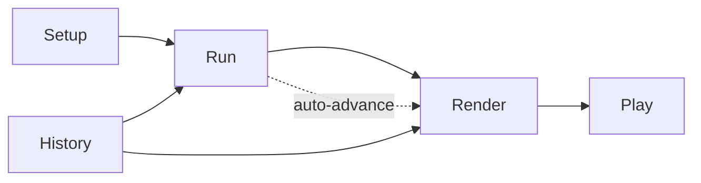
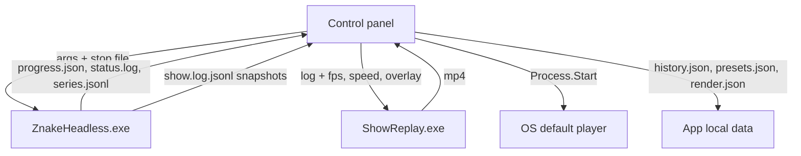
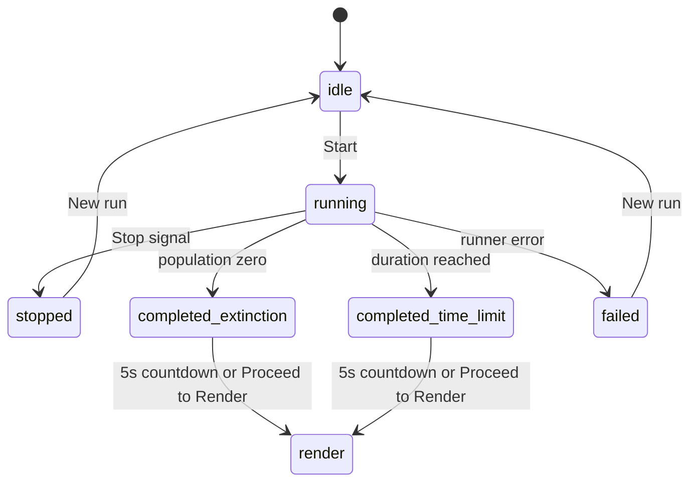
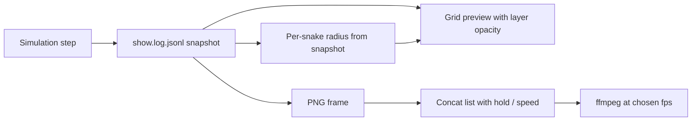

# Znake Control Panel - Plan

## Goal Capsule

- **Objective:** The operator can configure, run, monitor, and render a Znake headless show from one personal Windows app, including a vision-radius overlay and random spawn placement, without using PowerShell.
- **Means:** A new WinForms control panel executable that wraps the existing headless runner (`screensaver/tools/HeadlessShow.cs`) and renderer (`screensaver/tools/ShowReplay.cs`), per the Shell out Key Decision.
- **Product authority:** The control panel is the operator-facing front end; the runner and renderer remain the execution engines.
- **Open blockers:** None. The live-grid data channel, stop mechanism, and engine extensions are resolved in the Planning Contract.
- **Execution profile:** Deep plan; one operator; one run at a time; portable WinForms executable on .NET Framework.
- **Finish and ship:** `ce-work` implements, verifies, and ships the work; the operator runs the portable executable.

---

## Product Contract

### Summary

A personal Windows control panel that walks through Setup, Run, and Render for a Znake headless show. It adds run history and presets, a toggleable vision-radius overlay available live and in the rendered video, a choice between edge and random spawn placement, and render settings for fps and playback speed. The panel delegates simulation and encoding to the existing runner and renderer, extending them only where a promised feature needs a capability they lack.

### Problem Frame

The headless show pipeline already exists and works, but driving it means assembling long command lines, remembering paths and seeds, reading status files by hand, and rendering with fixed defaults. The operator has to know which flags matter, where outputs land, and how to choose fps or playback speed. A single app that owns the whole flow removes that friction and makes the vision overlay and spawn experiments easy to run.

### Actors

- A1. Operator — the sole user; configures runs, watches them, and renders videos on one Windows machine.

### Requirements

**Setup and configuration**

- R1. The operator can choose a background image file and see its dimensions.
- R2. The operator can set the grid zoom (square size) from 8, 13, 21, 34, with 8 as the default; values below 12 produce grids larger than the widget's smallest zoom.
- R3. The operator can set the cast count, seed, and saved-snake source; the saved snake defaults to the resident in `%LOCALAPPDATA%\Znake\Widget\world.json`.
- R4. The operator can set the game-time duration, snapshot interval, and run pace (unlimited or 1x).
- R5. The operator can choose spawn placement: edge entry (current behavior) or random placement inside the arena.
- R6. The operator can set the output root folder; the app creates a subfolder named from seed and timestamp (e.g., seed-20261127-2035) and creates it if missing.
- R7. The operator can save and load named presets of the setup fields; saving prompts for a name, confirms overwrite on duplicate, and allows rename and delete from the preset list.
- R7a. The app persists the last used setup and restores it on launch.

**Run execution and monitoring**

- R8. The operator can start a run; the app launches the headless runner with the configured arguments and prevents a second concurrent run.
- R9. The operator can stop a run; the app sends a graceful stop signal, waits for a timeout, forces termination only if needed, and records the stopped state in run history regardless of runner file state.
- R10. The Run step shows progress, game time, moves, population, and status from the runner's progress and status files, plus a toggleable tail of the status log.
- R10a. The Run step uses a state machine with states idle, running, stopped, completed-extinction, completed-time-limit, and failed; each state defines its controls and readouts and the transitions between them.
- R11. The Run step shows a live grid preview that can be toggled on and off; progress stats refresh every 0.5-1 s from progress.json, while grid geometry refreshes at the runner's snapshot interval (default 1 s, configurable).
- R12. The Run step shows a vision-radius overlay when enabled; the overlay is toggleable independently of the grid.
- R13. When a run completes (extinction or time limit), the Run step shows a 'Run complete' banner with a cancellable countdown to Render; a 'Stay on Run' action cancels the advance.

**Rendering and output**

- R14. The Render step lets the operator choose output fps (12.5 default, 30 available) and playback speed from 1x, 2x, 3x, 5x, 8x, 13x, 21x (1x default).
- R15. The Render step lets the operator choose whether the vision overlay is burned into the mp4.
- R16. The operator can start a render; the app runs the renderer and shows progress.
- R17. The operator can play the finished mp4 from the app by launching it with the OS default player (no embedded player).
- R18. The app records the render settings used for each run.

**Vision overlay**

- R22. The overlay shows a translucent radius around each snake matching `Gene.VisionRadius`; no cone or heading wedge is shown.
- R23. The overlay is available in the live view and as an option in the rendered mp4 (R15).

**Spawn placement**

- R24. Random placement puts each snake, including the saved snake, at a free coordinate inside the arena with no edge-entry phase.

**Run history and re-use**

- R19. The app lists past runs from their output folders and shows status, game time, moves, population outcome, and render state.
- R20. The operator can re-render a past run with new fps or speed settings; opening or deleting the output folder is left to Explorer.
- R25. The operator can compare two runs' population and moves curves.
- R32. The operator can star runs for quick access.
- R33. The app shows a post-run summary (moves, extinction time, saved-snake survival).

**Display and interaction**

- R26. The live grid supports layer toggles and opacity for snakes, fruit, vines, and the vision overlay.
- R27. The app supports dark and light themes.
- R28. The app shows a toast notification and plays a sound when a run completes.
- R29. The app supports keyboard shortcuts for start, stop, render, and play.

**Engine and invocation**

- R30. The app supports a dry run that validates configuration without launching.
- R31. The app generates a replayable run.ps1 for each run.
- R34. The operator can resume a run from its last saved checkpoint, including after manual edits to the checkpoint or settings.
- R35. The app and renderer use GPU acceleration for both live-grid rendering and video encoding when available, with CPU fallback.

### Key Decisions

- **Guided flow over workbench or dashboard.** Setup, Run, and Render are three sequential steps with a run summary sidebar; presets and run history live in a collapsible sidebar section on Setup and a History entry point reachable from any step. Governs R7, R8, R10, R13, R14, R19.
- **Personal tool.** No installer, no multi-user support, no documentation beyond the existing README; the app is a single portable exe. Governs R6, R7, R19.
- **Vision radius only.** The overlay uses the game's existing `Gene.VisionRadius`; a heading cone is out of scope. Governs R12, R15, R22.
- **Spawn placement is an option, not a default change.** Edge entry remains the default; random placement is opt-in. Governs R5, R24.
- **Playback speed is separate from run pace.** Render speed controls mp4 playback; Setup pace controls the simulation. Governs R4, R14.
- **Live preview refreshes at two cadences.** Progress stats refresh every 0.5-1 s and are fixed in v1; grid geometry refreshes at the configurable snapshot interval, default 1 s. Governs R11.
- **Render fps defaults to 12.5.** One frame per simulation step; 30 fps is available. Governs R14.
- **Shell out, do not embed.** The app invokes the existing runner and renderer; it does not run the simulation in-process. Governs R8, R16.
- **Full studio scope for v1.** History and presets are included, not deferred. Governs R7, R19, R20.
- **GPU acceleration covers both live-grid rendering and video encoding.** (session-settled: user-directed — chosen over GPU encoding only: the operator selected both paths.) Governs R35.

### Key Flows

- F1. Setup a run
  - **Trigger:** Operator opens the app or clicks New run.
  - **Steps:** Choose background, set grid/cast/seed/saved snake, set duration and pace, choose spawn placement, set output folder, optionally load a preset.
  - **Outcome:** A complete run configuration ready to launch.
- F2. Run a show
  - **Trigger:** Operator clicks Start on the Run step.
  - **Steps:** App launches the runner; Run step shows progress, stats, and optional live grid with vision overlay; app polls status until completion.
  - **Outcome:** Run finishes (extinction or time limit) and auto-advances to Render.
- F3. Render and play
  - **Trigger:** Run completes or operator opens a past run from history.
  - **Steps:** Operator sets fps and playback speed, toggles vision overlay, starts render, waits for completion, plays the mp4.
  - **Outcome:** A finished mp4 at the chosen settings.
- F4. Resume a run
  - **Trigger:** Operator selects a past run and chooses Resume.
  - **Steps:** App validates the checkpoint, launches the runner in resume mode, and monitors it as in F2.
  - **Outcome:** The run continues from the checkpoint with its existing log and a new terminal state.

### Acceptance Examples

- AE1. Given a configured run, when the operator clicks Start, the runner launches with the exact arguments shown in the setup summary and the Run step shows live progress.
- AE2. Given a running show, when the vision overlay is enabled, the live grid shows a translucent radius around each snake; when disabled, no overlay appears.
- AE3. Given spawn placement set to random, when the run starts, no snake enters from an edge and all bodies begin inside the arena.
- AE4. Given a completed run, when the operator renders at 30 fps and 13x speed, the mp4 plays in 1/13th of the game time and includes the vision overlay if selected.
- AE5. Given a past run in history, when the operator re-renders with new settings, a new mp4 is written without re-running the simulation.

### Success Criteria

- The operator can configure and launch a full 2-hour show without PowerShell.
- The operator can watch live progress and population without reading status files manually.
- The operator can render a real-time mp4 with a chosen fps and playback speed from the app.
- The vision overlay can be shown live and burned into the video.
- Random spawn placement works without edge entry.
- Run history and presets survive app restarts.

### Scope Boundaries

- **Deferred for later:** per-step live grid refresh; in-process simulation; advanced analytics beyond the two-run comparison; multiple concurrent runs.
- **Outside this product's identity:** installer or multi-user support; cone or heading-based vision; editing individual snake genomes; changing the simulation physics; importing runs produced by other tools; pan/zoom of the live grid; multi-monitor and high-DPI support; auto-update.

### Dependencies / Assumptions

- The app targets .NET Framework WinForms, matching the existing build (`screensaver/build.ps1`, csc.exe).
- The runner and renderer remain separate executables invoked by the app.
- The runner's progress.json and status.log provide enough data for monitoring.
- The show.log.jsonl format carries the bodies, fruits, eggs, and vines needed for the live grid and vision overlay; each snapshot must also carry each snake's effective vision radius (night-dependent) for both the live and rendered overlay.
- The saved snake comes from `%LOCALAPPDATA%\Znake\Widget\world.json` (resident id 639).
- The default seed is 20261127; the app may randomize or reuse it.
- Presets, history, and render state are stored as JSON files under the app's local data folder.
- The app resolves `ZnakeHeadless.exe` and `ShowReplay.exe` as sibling files in the build output directory, overridable by setting; `ShowReplay.exe` is produced by a new `-Replay` target matching the existing `-Headless` target.
- Random spawn requires runner work: a spawn-mode argument, in-arena placement with no Entering state, and validation that cast fits available cells.
- The runner writes a compact per-run time series so curves and post-run summaries have data at every progress interval.

### Outstanding Questions

None. The planning-time questions carried from the brainstorm are resolved as KTD1 (live-grid channel), KTD2 (stop signal), KTD4 (time series), KTD5 (panel-owned state), KTD6 (engine scope), and KTD8 (dry-run validation).

---

## Planning Contract

### Key Technical Decisions

- KTD1. The live grid tails `show.log.jsonl` through a byte-offset cursor opened with `FileShare.ReadWrite`, tolerating a partial trailing line; progress stats come from `progress.json` on a separate 0.5-1 s timer. Governs R11, R12, R26. The panel passes `--snapshot 1` explicitly because the runner's own default is 10 s.
- KTD2. Stopping writes a `--stop-file` marker the runner polls between chunks, then force-kills only after a timeout. (session-settled: user-approved — chosen over immediate force-kill: a stopped run keeps its log and final state.) Governs R9, R10a, R19.
- KTD3. Playback speed divides the renderer's per-frame hold by the selected factor; output fps stays independent because the concat duration, not the `fps` filter, sets video length. Governs R14, R17.
- KTD4. The runner appends `series.jsonl` at every progress interval with game seconds, moves, population, and saved-snake alive, and records saved-snake survival in the final progress record. (session-settled: user-approved — chosen over deriving curves from status.log: the 300 s status default is too sparse.) Governs R25, R33.
- KTD5. Panel-owned state lives in app-local `history.json` and a per-run `render.json` sidecar; simulation facts are read from the runner's output files. Governs R18, R19, R20, R32.
- KTD6. Engine extensions land in v1 as runner and renderer units rather than a separate plan. (session-settled: user-approved — chosen over a separate engine plan: the promised features depend on them.) Governs R5, R9, R12, R15, R25, R33, R34.
- KTD7. Live-grid GPU rendering sits behind a renderer interface with a GDI+ default path and is sequenced last. (session-settled: user-approved — chosen over deferring live-grid GPU: the operator confirmed both paths in v1.) Governs R35 and the GPU Key Decision.
- KTD8. Dry run delegates to a runner `--validate-only` mode instead of duplicating validation in the panel. Governs R30.
- KTD9. A same-minute folder-name collision gets a numeric suffix rather than overwriting the earlier run. Governs R6.
- KTD10. Completion banner uses a 5-second auto-advance countdown; **Stay on Run** cancels the countdown while remaining in `completed-extinction` or `completed-time-limit` with manual **Proceed to Render**, **Resume** (when stopped or time-limited), and **New Run** actions. (session-settled: user-approved — chosen over returning to idle: keeps the post-run summary and manual render/resume actions accessible.) Governs R10a, R13.
- KTD11. Stopping via `--stop-file` or `Ctrl+C` keeps `world.ShowComplete = false`, writes a well-formed trailing `snapshot` to `show.log.jsonl`, saves `world.json`, and records `status: "stopped"` in `progress.json` + `series.jsonl`; `StateStore.Valid` allows `0` or `1` residents when `ShowActive && ShowNoRespawn` is true, and `--resume` uses strict `world.json` validation without falling back to `world.previous.json`. (session-settled: user-approved — chosen over marking `ShowComplete = true` on stop: preserves `--resume` continuation and catches invalid manual checkpoint edits.) Governs R9, R19, R34.
- KTD12. GPU live-grid rendering (`U8`) uses built-in .NET Framework WPF `ElementHost` + `DrawingVisual` (`RenderCapability.Tier >> 16 >= 2`) with `GdiGridRenderer` as the correctness reference and fallback; `ShowReplay.exe` probes `h264_nvenc`, `h264_amf`, `h264_qsv` via 1-frame ffmpeg test with `libx264` fallback. (session-settled: user-approved — chosen over raw Direct2D/D3D11 COM P/Invoke: avoids brittle vtable bindings under C# 5 `csc.exe` with zero external packages.) Governs R35.

### High-Level Technical Design

**Component topology.** The panel owns configuration and display; the runner owns simulation and run files; the renderer owns frames and encoding; the OS player owns playback.

**Run state machine.** Completion states drive the banner and auto-advance; stopped is recorded by the panel even when the runner exits without a final progress write.

**Data flow for a single frame.** One snapshot feeds both the live overlay and the encoded video; speed changes only display duration.

### Resolved Implementation Details

- **GPU selection (`U2`, `U8`):** `ShowReplay.exe` probes `h264_nvenc`, `h264_amf`, `h264_qsv` (plus `--encoder <auto|cpu|nvenc|amf|qsv>`) with `libx264` fallback; `GpuGridRenderer` uses WPF `ElementHost` + `DrawingVisual` when `RenderCapability.Tier >> 16 >= 2` with `GdiGridRenderer` fallback (KTD12).
- **`series.jsonl` schema (`U1`):** Append-only JSONL rows at each progress interval and terminal exit with `utc`, `gameSeconds`, `wallSeconds`, `steps`, `moves`, `population`, `originalAlive`, and `savedSnakeAlive`.
- **Panel data & `render.json` ownership (`U4`, `U7`):** Panel-owned `settings.json`, `presets.json`, and `history.json` live under `%LOCALAPPDATA%\Znake\ControlPanel\`; `RenderStep` writes `render.json` into the run folder after `ShowReplay.exe` completes.

### Sources / Research

- `screensaver/tools/ShowReplay.cs` — concat list with `duration <hold>`, `fps` filter, libx264 fallback; basis for KTD3.
- `screensaver/tools/HeadlessShow.cs` — arguments, `Console.CancelKeyPress`, progress and status writes, run scripts; basis for KTD2 and KTD8.
- `screensaver/ShowLog.cs` — append-only JSONL with `FileShare.Read` and a tolerant reader; basis for KTD1.
- `screensaver/StateStore.cs` — atomic JSON writes, checkpoint lock, backup fallback; basis for KTD5 and resume.
- `screensaver/SettingsDialog.cs` and `screensaver/GenePanel.cs` — WinForms layout, load/save error handling, and timer refresh patterns.
- `screensaver/build.ps1` — csc.exe targets and `/warnaserror+`; basis for U3.

---

## Implementation Units

### U1. Runner controls for stop, spawn, validate, and resume

- **Goal:** Extend `HeadlessShow` so the panel can stop it cleanly, choose spawn placement, validate a configuration, and resume from a checkpoint.
- **Requirements:** R3, R4, R5, R8, R9, R24, R30, R31, R34
- **Dependencies:** none
- **Files:** `screensaver/tools/HeadlessShow.cs`, `screensaver/World.cs`, `screensaver/ShowLog.cs`, `screensaver/tests/HeadlessControlTests.cs`
- **Approach:**
  1. Add `--stop-file`, `--spawn`, `--resume`, and `--validate-only` arguments alongside the existing flags.
  2. Poll the stop file between work chunks and finalize progress before exiting; keep forced termination as the panel's fallback.
  3. Add an in-arena spawn path that places every snake on a free cell with no `Entering` state, rejecting a cast larger than the free-cell count.
  4. Save a `World` checkpoint through `StateStore` into the run folder at each progress interval and on stop or completion.
  5. Add a resume path that loads that same checkpoint, validates it, and appends to the existing log instead of clearing it.
  6. Append `series.jsonl` at each progress interval and write saved-snake survival into the final progress record.
  7. Keep `run.ps1`, `run-info.txt`, and status output compatible with the current format.
- **Execution note:** Add failing tests for stop-file, spawn, and resume behavior before changing the runner loop.
- **Patterns to follow:** `World.StartShow` and `AddOpeningSnake` for placement, `StateStore.Load` for checkpoints, `ShowLog.Open` for append-only output, and the existing `WriteProgress` contract.
- **Test scenarios:**
  - Covers AE3. Random spawn places all snakes inside the arena with `Entering=false`, including the saved snake.
  - Random spawn with a cast larger than the free-cell count fails validation before any file is written.
  - A stop-file marker written mid-run ends the loop after the current chunk and leaves a valid final `progress.json` and complete log record.
  - `--validate-only` returns a result without creating the output folder or writing the log.
  - A headless run writes a valid checkpoint at each progress interval and on stop or completion.
  - Resume from that checkpoint continues simulation and appends to the existing `show.log.jsonl`.
  - Resume rejects a checkpoint that fails `StateStore` validation after manual edits.
  - `series.jsonl` gains one row per progress interval, and the final record states whether the saved snake survived.
- **Verification:** Each scenario passes in `ZnakeTests.exe`, and a short headless run produces the same output files as before the change plus `series.jsonl`.

### U2. Snapshot radius and renderer speed and overlay

- **Goal:** Give snapshots the per-snake radius the overlay needs, and let the renderer burn the overlay into an mp4 at a chosen playback speed and fps.
- **Requirements:** R12, R14, R15, R22, R23, R35
- **Dependencies:** U1
- **Files:** `screensaver/ShowLog.cs`, `screensaver/Snake.cs`, `screensaver/tools/ShowReplay.cs`, `screensaver/tests/ReplayOverlayTests.cs`
- **Approach:**
  1. Add each snake's effective `Gene.VisionRadius` and night context to snapshot records, using `Snake.EffectiveGene` as the source of truth.
  2. Add an optional overlay pass to `DrawScene` driven by a new renderer flag.
  3. Add `--speed` and map it to `hold / speed` in the concat list; parse `--fps` as a double with invariant culture so the 12.5 default reaches the ffmpeg `fps=` filter.
  4. Select a GPU encoder when available and fall back to libx264.
- **Execution note:** Verify the hold mapping against a short log before adding the overlay pass.
- **Patterns to follow:** `ShowReplay.DrawScene`, `Gene.VisionRadius`, and `AgentControl.cs` night-dependent radius calculation.
- **Test scenarios:**
  - A snapshot carries a radius equal to the snake's night-dependent effective radius, including the zero-radius disable case.
  - With overlay off, frame pixels match current output; with overlay on, a translucent circle appears only around living snakes.
  - Speed 13x produces an mp4 one thirteenth the length of the 1x output for the same log.
  - The 12.5 fps default is accepted and produces a valid mp4, and changing fps alters encoded frame rate without changing video duration.
  - When no GPU encoder is present, the renderer completes with libx264.
- **Verification:** Tests pass and a rendered sample log produces correct durations at 1x and 13x with and without the overlay.

### U3. Build targets and executable layout

- **Goal:** Produce the panel, renderer, and runner as sibling portable executables and keep tests building against panel logic.
- **Requirements:** R16, R17
- **Dependencies:** U1, U2
- **Files:** `screensaver/build.ps1`, `screensaver/tools/ShowReplay.cs`, `screensaver/controlpanel/Program.cs`
- **Approach:**
  1. Add `-Replay` and `-ControlPanel` switches mirroring `-Headless`, including `/main` selection.
  2. Isolate panel sources under `screensaver/controlpanel/` so the default root `*.cs` glob does not pull extra entry points.
  3. Include panel logic sources in the `-Test` target so panel tests compile under `/main:Znake.Tests.TestRunner`.
  4. Keep `/warnaserror+` and the existing output directory convention.
- **Test expectation:** none — build and packaging only, verified by successful smoke and test builds.
- **Patterns to follow:** the existing `-Headless` and `-Test` branches in `screensaver/build.ps1`.
- **Verification:** All four targets build without warnings, and the panel resolves the runner and renderer beside itself.

### U4. Panel shell, guided flow, theme, shortcuts, and notifications

- **Goal:** Provide the three-step window, sidebar, run summary, palette, persisted setup, shortcuts, and completion notification.
- **Requirements:** R7a, R8, R10, R13, R16, R27, R28, R29
- **Dependencies:** U3
- **Files:** `screensaver/controlpanel/Program.cs`, `screensaver/controlpanel/MainForm.cs`, `screensaver/controlpanel/Theme.cs`, `screensaver/controlpanel/AppSettings.cs`, `screensaver/tests/ControlPanelShellTests.cs`
- **Approach:**
  1. Build the shell with `TableLayoutPanel` and `FlowLayoutPanel`, using `AutoScaleMode.Dpi` and explicit minimum size.
  2. Place presets and history in the Setup sidebar and a History entry point reachable from every step.
  3. Introduce a small shared palette for dark and light themes and replace hardcoded colors in panel-owned controls.
  4. Restore last used setup on launch through atomic JSON writes following `SettingsDialog` error handling.
  5. Bind F5 to start, F6 to stop, F7 to render, and F8 to play, and handle them only when no text input has focus.
  6. Show the completion banner with a cancellable countdown, a Stay on Run action, a toast, and a sound.
- **Patterns to follow:** `SettingsDialog` load/save, `GenePanel` timer and owner-drawn list patterns, and `JsonFiles` atomic writes.
- **Test scenarios:**
  - Last used setup is restored after a simulated restart.
  - Switching theme changes palette colors on all panel-owned controls.
  - Shortcut keys are ignored while a preset-name text box has focus.
  - Completion countdown is cancelled by Stay on Run and the app remains on the Run step.
  - Completion triggers one toast and one sound notification.
- **Verification:** Application starts, restores settings, and all three steps are reachable without an unhandled exception.

### U5. Setup step, presets, dry run, and folder naming

- **Goal:** Expose every setup field, manage presets, validate before launch, and create collision-safe output folders.
- **Requirements:** R1, R2, R3, R4, R5, R6, R7, R30, R31
- **Dependencies:** U4, U1
- **Files:** `screensaver/controlpanel/SetupStep.cs`, `screensaver/controlpanel/PresetStore.cs`, `screensaver/tests/SetupStepTests.cs`
- **Approach:**
  1. Build fields for background, zoom, cast, seed, saved snake, duration, pace, snapshot interval, spawn placement, and output root.
  2. Read background dimensions without retaining the image in memory.
  3. Implement preset save/load, duplicate-name overwrite confirmation, rename, and delete.
  4. Call the runner's `--validate-only` mode for dry run and show its result.
  5. Compose the output subfolder from seed and timestamp, appending a numeric suffix when it already exists.
  6. Surface the exact argument list that will be passed to the runner.
- **Patterns to follow:** `SettingsDialog` validation and status label, `JsonFiles` persistence, and the runner argument contract in `HeadlessShow`.
- **Test scenarios:**
  - Zoom offers exactly 8, 13, 21, and 34 with 8 selected by default.
  - A duplicate preset name prompts for overwrite; rename and delete update the preset list.
  - Dry run reports an oversized cast without launching the runner.
  - An existing seed-and-timestamp folder produces a suffixed folder name instead of an overwrite.
  - Background selection displays width and height from the chosen image.
  - The displayed argument string matches the values set in the form.
- **Verification:** A configured setup yields a valid runner invocation and a unique output folder.

### U6. Run step, live grid, overlay, and stop

- **Goal:** Launch and monitor the runner, show progress and a two-cadence live preview, support layer controls, and stop cleanly.
- **Requirements:** R8, R9, R10, R10a, R11, R12, R22, R26, R33
- **Dependencies:** U1, U2, U4
- **Files:** `screensaver/controlpanel/RunStep.cs`, `screensaver/controlpanel/GridPreview.cs`, `screensaver/controlpanel/LogTail.cs`, `screensaver/tests/RunStepTests.cs`
- **Approach:**
  1. Launch the runner with a stop-file path and enforce the single-run rule.
  2. Poll `progress.json` and `status.log` on a 0.5-1 s timer and tail `show.log.jsonl` with a byte cursor at the snapshot cadence.
  3. Apply layer toggles and opacity for snakes, fruit, vines, and the radius overlay.
  4. Drive the six-state machine and record stopped state in history from the panel.
  5. Write the stop-file marker on Stop, then kill only after the timeout.
  6. Show the post-run summary from the final progress and series records.

| State | Enabled controls | Readouts |
|---|---|---|
| idle | Start, preset load | Last run summary, configured arguments |
| running | Stop, grid and overlay toggles, layer controls | Progress, game time, moves, population, status tail |
| stopped | Start, New run | Final progress, game time, stopped status |
| completed-extinction | Stay on Run, Continue to Render | Extinction time, moves, saved-snake survival |
| completed-time-limit | Stay on Run, Continue to Render | Final population, moves, saved-snake survival |
| failed | New run | Error text, last known progress |

- **Execution note:** Start with a failing test for partial-line tolerance in the log tail.
- **Patterns to follow:** `ShowLog.ReadLog` for tolerant reads, `GenePanel` for timer refresh, and `ShowReplay.DrawScene` for scene composition.
- **Test scenarios:**
  - State transitions follow idle, running, stopped, completed-extinction, completed-time-limit, and failed.
  - A trailing incomplete JSON line is ignored and picked up on the next tick.
  - Stats refresh at the short cadence while grid geometry changes only at snapshot intervals.
  - Toggling a layer or changing its opacity redraws only that layer.
  - The radius overlay appears independently of the grid toggle.
  - Stop records the stopped state in history even when the runner leaves no final progress file.
  - Post-run summary reports moves, extinction time, and saved-snake survival.
- **Verification:** A short run shows changing progress and geometry, stops cleanly, and leaves a readable log.

### U7. Render step and run history

- **Goal:** Render a run at chosen settings, play the result, and support history, re-render, starring, and comparison.
- **Requirements:** R14, R15, R16, R17, R18, R19, R20, R25, R32
- **Dependencies:** U2, U5, U6
- **Files:** `screensaver/controlpanel/RenderStep.cs`, `screensaver/controlpanel/HistoryStore.cs`, `screensaver/controlpanel/CompareView.cs`, `screensaver/tests/RenderHistoryTests.cs`
- **Approach:**
  1. Offer fps, playback speed, and overlay burn-in; launch the renderer with the mapped arguments and show progress.
  2. Write `render.json` with the settings used and play the finished mp4 with `Process.Start` and the OS default player.
  3. Build history from app-local `history.json` and runner output files, with star state persisted.
  4. Re-render a past run from its log without re-running the simulation.
  5. Compare two runs by plotting population and moves from `series.jsonl`.
- **Patterns to follow:** `ProcessStartInfo` usage in `HeadlessShow`, `JsonFiles` persistence, and `StateStore` atomic writes.
- **Test scenarios:**
  - Covers AE4. Rendering at 30 fps and 13x produces the expected shorter mp4 and honours the overlay choice.
  - Covers AE5. Re-rendering a past run writes a new mp4 without launching the runner.
  - History shows status, game time, moves, population outcome, and render state for a completed run.
  - Starring a run persists across a simulated restart.
  - Comparing two runs reads both series files and produces two population and moves curves.
  - Play launches the mp4 through the OS default player without an embedded control.
- **Verification:** A completed run can be re-rendered and compared from history, and playback opens externally.

### U8. GPU live-grid rendering with CPU fallback

- **Goal:** Add optional GPU acceleration for the live grid without making it a dependency for correct rendering.
- **Requirements:** R35
- **Dependencies:** U6
- **Files:** `screensaver/controlpanel/GridRenderer.cs`, `screensaver/controlpanel/GdiGridRenderer.cs`, `screensaver/controlpanel/GpuGridRenderer.cs`, `screensaver/tests/GridRendererTests.cs`
- **Approach:**
  1. Define a renderer interface carrying the layer and opacity contract from U6.
  2. Keep the existing GDI+ path as the default implementation.
  3. Add a GPU implementation selected when the adapter is available, with automatic fallback.
- **Execution note:** Treat the GDI+ path as the correctness reference and verify the GPU path against it.
- **Patterns to follow:** `ShowReplay.DrawScene` composition and the compositing modes used there.
- **Test scenarios:**
  - When no GPU adapter is available, preview creation returns the GDI+ renderer.
  - Both renderers produce the same visible layer composition for a sample snapshot.
  - Layer opacity settings are applied by both implementations.
- **Verification:** Preview renders correctly with GPU enabled and after forcing fallback.

---

## Verification Contract

| Check | Command or action | Applies to |
|---|---|---|
| Unit tests | `powershell -NoProfile -File screensaver/build.ps1 -Test` | U1, U2, U4, U5, U6, U7, U8 |
| Target builds | `powershell -NoProfile -File screensaver/build.ps1 -Headless`, `-Replay`, `-ControlPanel` | U1, U2, U3 |
| Smoke build | `powershell -NoProfile -File screensaver/build.ps1 -Smoke -Widget` | U3, U4 |
| Short headless run | Launch the built runner with a 30-second duration, small cast, and the full background; inspect output files | U1, U6 |
| Render timing | Render the same log at 1x and 13x and compare mp4 durations | U2, U7 |
| Panel smoke | Launch the portable exe, complete one Setup -> Run -> Render cycle, then restart and confirm restored setup and history | U4, U5, U6, U7 |

The build script runs tests automatically after compiling the `-Test` target and throws on a non-zero exit code. `/warnaserror+` makes warnings build failures; no target may introduce one.

---

## Definition of Done

Global:

- All eight units are implemented, their test scenarios pass, and every target builds warning-free.
- The acceptance examples AE1 through AE5 hold against the built executables.
- The runner and renderer remain separate executables; no simulation code is moved into the panel.
- Panel-owned state survives a restart and does not overwrite runner-owned output files.
- Abandoned experiment code and scratch files are removed from the diff.

Per-unit:

| Unit | Done signal |
|---|---|
| U1 | Stop, spawn, validate, resume, series log, and saved-snake survival work in a short headless run |
| U2 | Snapshots carry radius; overlay and speed flags produce correct mp4s with a CPU fallback |
| U3 | All four build targets succeed with `/warnaserror+` |
| U4 | Three-step shell, palette, shortcuts, persistence, and completion behavior verified in the running app |
| U5 | All setup fields, preset lifecycle, dry run, and collision-safe folders verified |
| U6 | Live preview, state machine, layer controls, stop, and summary verified against a live runner |
| U7 | Render settings, playback, history, re-render, star, and comparison verified |
| U8 | GPU path verified against the GDI+ reference with forced fallback |
